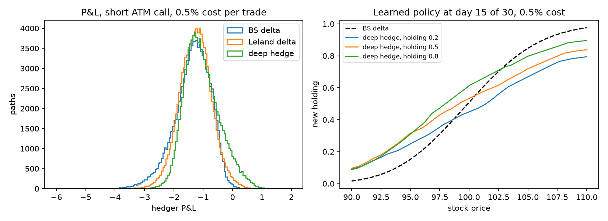

# Deep Hedging

A neural network learns to hedge a short option under transaction costs (Buehler et al., *Deep Hedging*, 2019). It's trained to minimize tail risk (CVaR) and compared against Black-Scholes delta hedging and Leland's cost-adjusted delta.

**Result:** with costs, the learned hedge cuts 95% CVaR by 27% against BS delta and 13% against Leland at 0.5% cost, mostly by learning to trade less.

## Setup

- **Position:** short one at-the-money European call (S₀ = K = 100, σ = 20%, 30 trading days), hedged with the stock once a day.
- **Market:** geometric Brownian motion, r = 0, zero drift. Proportional cost on every trade, including opening the hedge and unwinding it at expiry.
- **P&L:** premium (Black-Scholes price) − payoff + hedging gains − costs. The same premium is used for every strategy, so comparisons are like for like.
- **Network:** an MLP (3 → 32 → 32 → 1) shared across time. Inputs are normalized log-moneyness, time to maturity, and the **current holding**. That last input is what lets it learn not to trade.
- **Training:** Adam, 1,500 steps × 8,192 freshly simulated paths, minimizing CVaR₉₅ of the hedger's loss.
- **Evaluation:** 100,000 separate paths, never seen in training.
- **Baselines** come from my [option pricer](../option-pricer), installed as a package:
  - **BS delta:** ∂C/∂S at the true volatility.
  - **Leland delta:** delta at an inflated volatility σ²(1 + √(2/π)·k/(σ√Δt)), the classic analytical fix for costs.

## Results (100k test paths)

| Cost per trade | Strategy | Mean P&L | Std | CVaR₉₅ ↓ | Turnover |
|---|---|---|---|---|---|
| 0% | BS delta | −0.001 | **0.432** | 1.007 | 2.71 |
| | Leland delta | −0.001 | 0.432 | 1.007 | 2.71 |
| | Deep hedge | −0.001 | 0.492 | **0.896** | 2.57 |
| 0.1% | BS delta | −0.275 | 0.450 | 1.366 | 2.71 |
| | Leland delta | −0.270 | **0.446** | 1.292 | 2.66 |
| | Deep hedge | **−0.247** | 0.510 | **1.166** | 2.43 |
| 0.5% | BS delta | −1.370 | 0.622 | 2.894 | 2.71 |
| | Leland delta | −1.270 | **0.549** | 2.447 | 2.51 |
| | Deep hedge | **−1.045** | 0.600 | **2.124** | 2.07 |

Unhedged, for scale: std 4.20, CVaR₉₅ 12.33. Turnover is the average total shares traded per path.



### Reading this honestly

1. **The network wins on the metric it was trained on (CVaR), not on everything.** At zero cost, BS delta has the lower standard deviation: delta hedging is roughly variance-optimal, while CVaR-optimal hedging trades a slightly wider distribution for a thinner left tail. With costs, the network also has the best mean P&L, but Leland still has a lower standard deviation.
2. **The improvement grows with costs** (CVaR −11% vs delta at 0%, −15% at 0.1%, −27% at 0.5%), because the network learns to trade less: 24% less turnover than delta at 0.5%.
3. **The learned policy (right panel) is flatter than BS delta**, the same direction as Leland's inflated volatility. It is also sticky: given a higher current holding, it keeps a higher holding. That's a soft version of the no-trade band that optimal-hedging theory predicts under costs (Whalley & Wilmott), though not a sharp band.
4. **This is a model world.** The paths are GBM at a known volatility, so the network is learning to hedge *this simulator*. Its real value would show under dynamics without closed-form hedges, such as stochastic volatility or jumps.

## Tests (`pytest`)

- **Accounting:** a costless delta hedge breaks even on average, and its error halves when rebalancing is 4× more frequent (√Δt scaling).
- **CVaR** equals the mean of the worst 5%. This test caught a real floating-point bug: `(1 − 0.95) × 100 = 5.000000000000004`, so `ceil` returned 6.
- **Costs** only ever reduce P&L, path by path.
- **Leland** reduces to BS delta at zero cost.
- **No lookahead:** scrambling prices after day *t* leaves the network's holdings up to *t* unchanged.
- **A short training run** already beats delta on CVaR and trades less, under costs.

## Run

```bash
python -m venv .venv
.venv/bin/pip install -r requirements.txt   # includes ../option-pricer as an editable package
.venv/bin/pytest -q
.venv/bin/python run_example.py             # ~3 minutes on CPU, writes hedging.png
```

## Limitations and next steps

- GBM with known volatility only. **Heston stochastic volatility** (hedging with stock plus a variance instrument) is the natural next step and where deep hedging is genuinely useful.
- One option, one maturity, and one network per cost level. The network doesn't generalize across strikes or costs; adding them as inputs would fix that.
- No hyperparameter search, and results come from a single training seed. Several seeds with error bars would make the comparison tighter.
- No real market data. Calibrating the simulator to SPY options, or using the volatility forecaster's output as σ, would connect it to the other projects.
